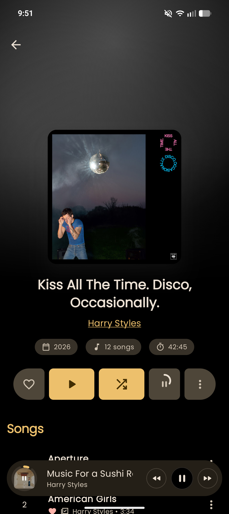
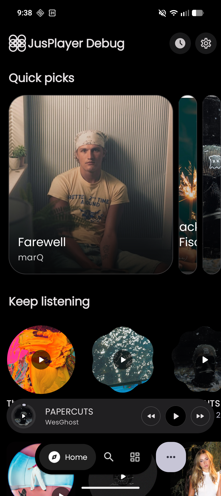
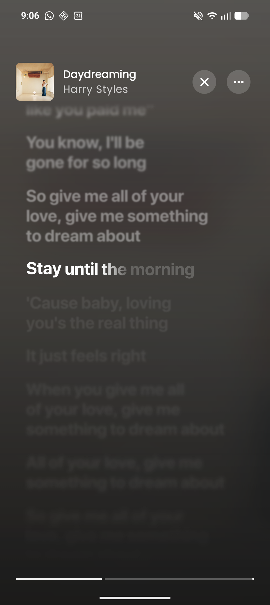
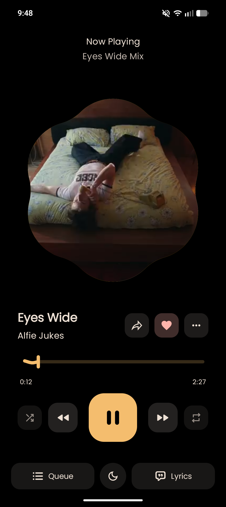

<div align="center">


# JusPlayer

**A YouTube Music client for Android.**<br>
_No ads, no Premium — your playlists, your files, your lyrics, on phone, tablet or TV._

Fork of [ArchiveTune](https://github.com/rukamori/ArchiveTune) by Rukamori · GPL-3.0 · Android 8.0+<br>
_docs: [English](README.md) · [日本語](README_JA.md)_

[**⬇ Download the APK**](https://github.com/shubh72010/Greeny-Goblins/releases/latest) &nbsp;·&nbsp; [All releases](https://github.com/shubh72010/Greeny-Goblins/releases) &nbsp;·&nbsp; [Full feature list](FEATURES.md) &nbsp;·&nbsp; [Discord](https://discord.gg/8VDJB7HztQ)







</div>

---

## What this is

A music player for your YouTube Music account — the streaming library, plus the music files already
on your phone, plus a Subsonic server if you run one. No ads, no Premium, no tracking.

It's a fork, so most of the app's bones are ArchiveTune's. What I've added on top is below and in
detail in [FEATURES.md](FEATURES.md) — that file is written from the source tree, not from this page.

> [!IMPORTANT]
> **Region:** if YouTube Music doesn't serve your country, you need a VPN/proxy set to a supported
> region for the first fetch. The app has built-in proxy, DoH and IP-rotation settings for this.

---

## What you get

- **No ads, no Premium.** Play anything from YouTube Music without ads and without paying, and keep
  listening with the screen off or the app in the background.
- **Your library is already there.** Sign in once and your liked songs, playlists and subscriptions
  appear as they are. Switching from Spotify? Import your playlists instead of rebuilding them.
- **Offline listening.** Download songs, albums or playlists and play them on a plane, on the metro,
  anywhere. Plus a sleep timer, skip-silence and crossfade between tracks.
- **Lyrics that follow the song.** Line-by-line and word-by-word, from 12 providers, with translation
  and romanization when you don't know the language.
- **It looks how you want.** Colours pulled from the album art, 69 palettes, 10 player layouts,
  8 home-screen widgets, an always-on-display player, and a font you can swap.
- **Listen together.** Start a session on your Wi-Fi or over the internet — everyone hears the same
  song at the same time, and guests can add tracks.
- **Your own files and your own server.** Local music on the phone and Navidrome/Airsonic/Gonic/
  Ampache sit in the same library as streaming, with no separate app.
- **Phone, tablet, TV.** Layouts that fit the screen, plus Android Auto and Google Cast (`gms` build).
- **Find that song.** Shazam-style recognition from the microphone or from whatever's playing on your
  phone — useful when you hear something in a café.
- **Your listening stays yours.** No analytics, no telemetry, no ads. Statistics, fingerprints and
  history are stored on the device only. Open source, GPL-3.0.

Under the hood there's more — dual-engine stream resolution with bitrate/codec tie-breaks, a
240-row searchable settings tree, 27 languages, 20 build variants — but you don't need any of it to
press play.

→ [Everything else, feature by feature](FEATURES.md)

---

## Install

Download the APK from [Releases](https://github.com/shubh72010/Greeny-Goblins/releases/latest) and
install it. There are two builds — pick one:

| File name contains | What it is |
|---|---|
| `gms` | The normal one. Includes Google Cast (casting to a TV or speaker). |
| `foss` | The same app with no Google code inside. No Cast. |

The app updates itself (Stable and Canary channels), so you don't have to re-download by hand.

> [!WARNING]
> The GitHub Releases page above is the only trusted download source. Builds from anywhere else
> are not mine.

**What needs what:** a YouTube Music account for your library · a Subsonic server for Subsonic
playback · a Spotify account for importing playlists · an API key from any AI service for the
optional AI mixes/translation · the `gms` build for Cast · the `tv` build for the TV layout.
Local files need nothing at all.

**Not here:** SponsorBlock, a Wear OS app, iOS, desktop, and no Google Play listing. This is an
independent third-party client — not affiliated with Google or YouTube.

---

## Build it

JDK 21. The project has 3 flavour dimensions (`gms`/`foss` × `mobile`/`tv` × `universal`/per-ABI),
so every task needs a variant name — bare `assembleDebug` tries to build all 20 and will not do what
you want.

```bash
./gradlew assembleGmsMobileUniversalDebug              # one debug APK
./gradlew :app:compileGmsMobileUniversalDebugKotlin    # fastest correctness check
./gradlew :app:lintGmsMobileUniversalDebug             # lint
./gradlew :app:testGmsMobileUniversalDebugUnitTest     # unit tests
./gradlew assembleGmsMobileUniversalRelease            # signed release (needs keystore secrets)
```

Full setup, signing keys and architecture notes: [CONTRIBUTING.md](CONTRIBUTING.md) ·
[ARCHITECTURE.md](ARCHITECTURE.md).

---

## How this is built

Written by me, with AI assistance. I use whatever free models happen to be available in
[opencode](https://opencode.ai) at the time — they change weekly, so there's no single model to
credit — plus the assistants' own tooling. I review every change, run the build and tests, test on
real devices, and decide what ships. Design, feature decisions and the crossfade/playback behaviour
are mine. If it's broken, it's my bug, not a model's.

I'm saying this up front because you're going to see it in the commit history anyway, and because a
music player should be honest about where its audio and your data come from — same principle.

Found a real bug? [Open an issue](https://github.com/shubh72010/Greeny-Goblins/issues/new/choose)
with steps and a log from the in-app log viewer. That's more useful than telling me it looks
generated.

---

## Translating

The app ships 27 locale sets and is translated on Weblate. Corrections are welcome — especially if
a string reads like machine output in your language.

[](https://translate.codeberg.org/engage/archivetune/)

---

## Credits

- [ArchiveTune](https://github.com/rukamori/ArchiveTune) by Rukamori — the fork base.
- [Metrolist](https://github.com/mostafaalagamy/Metrolist) by Mostafa Alagamy — the underlying framework.
- [SimpMusic](https://github.com/maxrave-dev/SimpMusic) by maxrave-dev — lyrics API provider.
- [BetterLyrics](https://better-lyrics.boidu.dev/) — word-by-word lyrics, unison and artwork providers.
- [Material Color Utilities](https://github.com/material-foundation/material-color-utilities).
- [Read You](https://github.com/Ashinch/ReadYou) and [Seal](https://github.com/JunkFood02/Seal) — UI inspiration.
- Everyone who filed an issue, tested a build, or fixed a translation.

**Maintainers:** shubh72010 (lead) · oliver-lebaigue-2-bright-bench (contributor)

---

## License

GPL-3.0. Third-party client; not affiliated with Google LLC or YouTube; doesn't bypass YouTube's
technical protections. Please buy the music you love from the artists.
